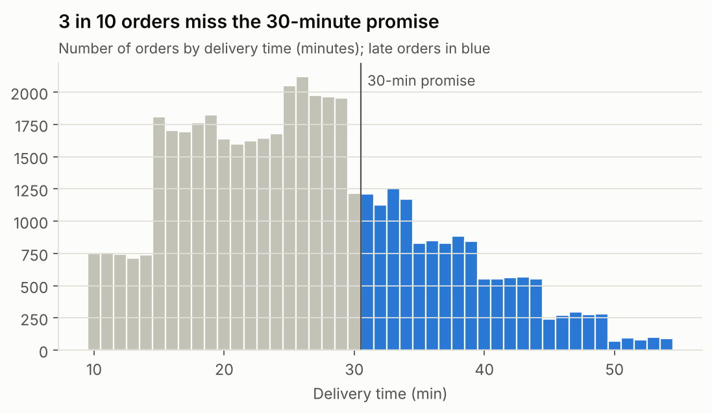
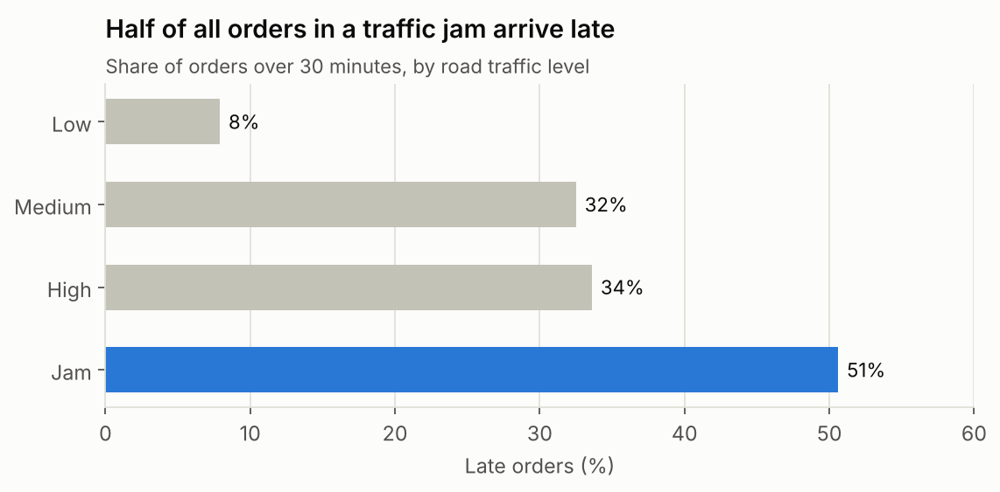
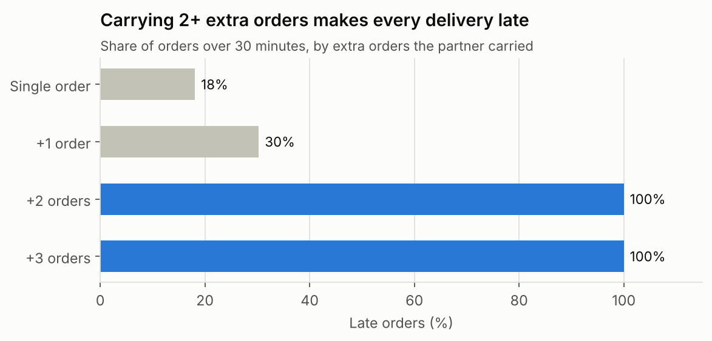
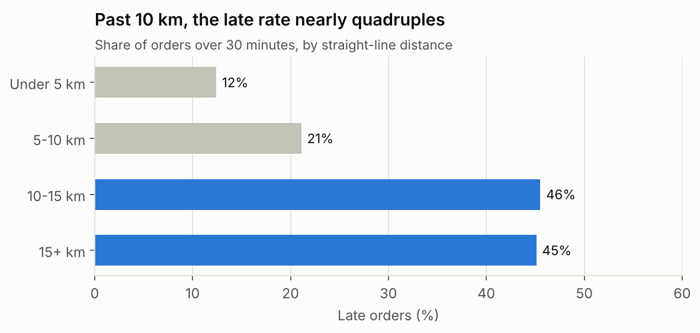
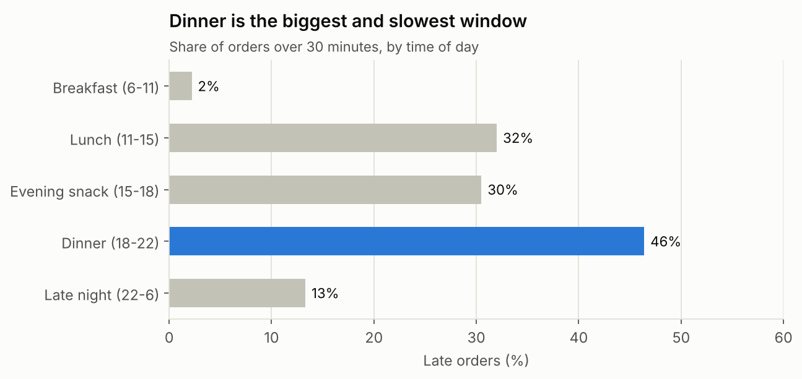

# Delivery Ops Analytics

**What makes on-demand deliveries late, and what should an ops team fix first?**

An end-to-end analysis of **45,593 food-delivery orders** across **22 Indian cities** and **1,320 delivery partners** (Feb–Apr 2022). I cleaned the raw export in Python, loaded it into SQLite, answered 11 business questions in SQL, and turned the results into charts, an interactive dashboard and five concrete recommendations.

**Tools:** Python (pandas, NumPy, Matplotlib) · SQL (SQLite: CTEs, window functions, CASE bucketing) · Jupyter · HTML/JavaScript dashboard (Chart.js)

> An order is counted as **late** if it took **more than 30 minutes**.



---

## Key findings

| # | Finding | Evidence |
|---|---|---|
| 1 | **Traffic is the biggest driver.** Late rate goes from 8% on clear roads to 51% in a jam. | `sql/analysis.sql` Q2 |
| 2 | **Dinner (6–10 pm) is the pressure point.** It brings ~42% of all orders, and about 3 in 4 of them hit jammed roads. 46% of dinner orders are late vs 2% at breakfast. | Notebook §3 |
| 3 | **Stacking 2+ extra orders on one partner makes every delivery late** (100% late, 40+ min average). One extra order is manageable (30% late). | Q5 |
| 4 | **Distance past 10 km nearly quadruples the late rate** (12% under 5 km → ~45% over 10 km). | Q10 |
| 5 | **Festival days are a planning failure:** all 896 festival orders were late, averaging 45.5 min vs 26 min normally. | Q6 |
| 6 | **Partners rated below 4.5 are late on 80%+ of their orders.** This is a correlation (low ratings may be caused by lateness), but it's a cheap early-warning signal. | Q8 |
| 7 | **City barely matters.** All 22 cities sit between 29% and 33% late, so fixes should target conditions, not locations. | Q7 |

<p>




</p>

## Recommendations

| Problem | Late rate | Action |
|---|---|---|
| Dinner rush, mostly in jammed traffic | 46% | Add partners and position them inside busy zones before 6 pm |
| Partner carrying 2+ extra orders | 100% | Cap batching at one extra order per partner |
| Customer more than 10 km away | ~45% | Tighten the service radius; dispatch from the nearest micro-market |
| Festival days | 100% | Schedule surge staffing ahead of known festival dates |
| Partners rated below 4.5 | 84% | Flag early for coaching and lighter order loads |

**Why this matters beyond food delivery:** any on-demand service that sends workers to customers in local zones (home services, quick commerce, pharmacy delivery) faces the same levers: peak-hour supply, how many jobs one worker carries, service radius, and planning for predictable spikes.

## Interactive dashboard

`dashboard/index.html` is a single self-contained page: KPI tiles, six "what drives late orders" charts, a city ranking and the action table. A **city filter** recomputes everything for one city, and every bar shows orders, late rate and average time on hover.

Open it directly in a browser, or host it free with GitHub Pages (Settings → Pages → Deploy from branch → `/ (root)`), then visit `https://nidhiepnayak.github.io/delivery-ops-analytics/dashboard/`.

---

## Data cleaning (what was wrong with the raw file)

The raw export looked tidy but wasn't. `src/clean.py` fixes:

- Every text value was padded with spaces, and missing values were stored as the text `"NaN"`
- Delivery time stored as text like `(min) 24`; weather as `conditions Sunny`
- 431 restaurant latitudes and 162 longitudes were negative (sign errors); ~3,600 rows had zero coordinates
- Impossible values: partner ages of 15, ratings of 6 on a 5-star scale
- Orders placed before midnight and picked up after it gave negative wait times

It also **engineers new fields**: straight-line distance (haversine formula), pickup wait time, order hour, meal-time slot, weekday, and the partner's city (decoded from the partner ID, e.g. `BANGRES18DEL02` → Bengaluru).

After cleaning, no column is more than 8% missing, so each question uses all rows that have the field it needs rather than dropping whole orders.

## One thing I'd check with the data owner

Vehicles marked condition **0 (best)** are ~6 minutes *slower* than condition 1–2 at every traffic level, and all of them are motorcycles. That's the opposite of what you'd expect, so I treated it as a likely labelling issue and left it out of the recommendations.

## Limitations

- Delivery time is the only outcome (no cancellations, revenue or customer churn)
- Distance is straight-line, not road distance
- Only 8 weeks of data, so no seasonality beyond festival days

---

## Project structure

```
delivery-ops-analytics/
├── data/
│   ├── raw/food_delivery_raw.csv      # original Kaggle export
│   └── processed/                     # created by clean.py (git-ignored)
├── src/
│   ├── clean.py                       # cleaning + feature engineering → CSV + SQLite
│   ├── build_dashboard.py             # aggregates data into the dashboard
│   └── chart_style.py                 # shared chart styling
├── sql/analysis.sql                   # 11 business questions in SQL
├── notebooks/analysis.ipynb           # full analysis with charts and findings
├── outputs/charts/                    # exported PNG charts
└── dashboard/index.html               # interactive dashboard
```

## How to run

```bash
pip install -r requirements.txt
python src/clean.py                 # builds data/processed/deliveries.db
python src/build_dashboard.py       # rebuilds dashboard/index.html
jupyter notebook notebooks/analysis.ipynb

# or run the SQL directly
sqlite3 data/processed/deliveries.db < sql/analysis.sql
```

## Data source

[Food Delivery Dataset](https://www.kaggle.com/datasets/gauravmalik26/food-delivery-dataset) by Gaurav Malik on Kaggle. Used here for learning and portfolio purposes.
